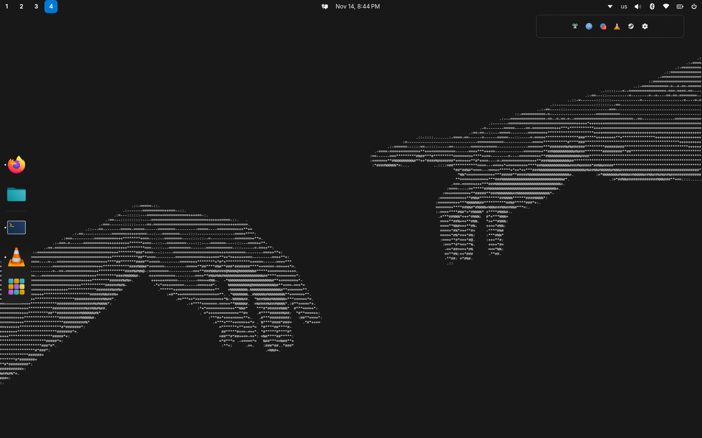

# Collapsible Tray Icon
A minimalist applet for [COSMIC](https://system76.com/cosmic) desktop environment to minimize **Tray Icons**.
This project forked from [this ptoject](https://github.com/marcelogomes90/cosmic-ext-applet-status-hub).


## Installation
### Install from source code
Clone the repository or download the latest release then go to the project directory and run this just command:
```bash
just install
```

- You might need Rust compiler and just installed.
- This method may require superuser privileges.

## Contributing
ARCHITECTURE.md explains how the tray core, the lifecycle arbitration, and the applet fit together, and why the core carries no iced dependency.
Read it before moving code across that boundary.
```bash
just verify   # fmt, clippy -D warnings, tests, and metadata validation
```

## Translating
Translations are Fluent catalogues under i18n/<locale>/status-hub.ftl.
To add a language, copy i18n/en/status-hub.ftl into a new locale directory and translate the values — the keys must stay as they are.
A test asserts every catalogue carries exactly the same keys as the English one, so a drifting translation fails the build rather than shipping as a blank label.

## Licence
GPL-3.0-only. See LICENSE.
